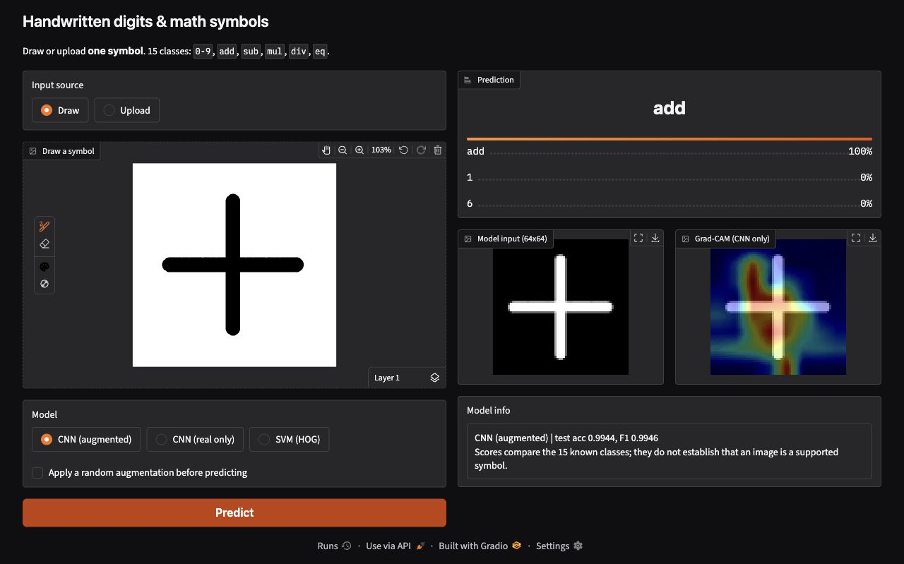

# Handwritten digits & math symbols recognition

[](https://github.com/altynbk/handwritten-math-recognition/actions/workflows/checks.yml)

Recognize **one handwritten symbol** from 15 classes: digits `0–9` and `add`,
`sub`, `mul`, `div`, `eq`. This educational computer-vision project compares
HOG + linear SVM with a small CNN trained on real images and the same CNN trained
with augmentation. A local Gradio application supports drawing, image upload,
model comparison and Grad-CAM visualization.

The dataset and all three trained models are included. **No training is needed
to run the demo or verify the results.**

## Install and run

Use **Python 3.12**. Run these commands in a terminal:

```bash
git clone https://github.com/altynbk/handwritten-math-recognition.git
cd handwritten-math-recognition
python3.12 -m venv .venv
source .venv/bin/activate
python -m pip install -r requirements.txt
python app.py
```

On Windows, create the environment with `py -3.12 -m venv .venv` and activate it
with `.venv\Scripts\Activate.ps1` in PowerShell. Skip cloning and environment
creation if you already have this repository and its environment.

Open the local address printed by Gradio, normally
[http://127.0.0.1:7860](http://127.0.0.1:7860).

1. Choose **Draw** or **Upload**. Only the selected source is used.
2. Select the brush tool and draw, or upload a single symbol with a clear,
   contrasting background. Undo, redo and clear are available on the canvas.
3. Select a model and press **Predict**. The default is the augmented CNN.
4. Inspect the normalized model input and, for CNNs, the Grad-CAM overlay.

Empty images are rejected. CNN scores compare the 15 known classes; they are
not calibrated guarantees of correctness. SVM displays a class without
probabilities. The optional augmentation checkbox applies a new random
perturbation for demonstration, so repeated clicks can give different results.



## Results

The SVM uses HOG features (9 orientations, 8×8-pixel cells, 2×2-cell blocks)
and a linear classifier. Both CNNs use four `Conv2D → BatchNorm → MaxPool`
blocks with 32, 64, 128 and 256 filters, followed by global average pooling,
50% dropout and a 15-class softmax layer. Training uses Adam, batch size 64,
early stopping and learning-rate reduction based on validation loss.

Held-out test: **1,608 images**. The augmented test is a fixed-seed transformed
copy of those same images.

| Model | Clean accuracy | Clean macro F1 | Augmented accuracy | Augmented macro F1 |
|---|---:|---:|---:|---:|
| SVM (HOG) | 0.9639 | 0.9640 | 0.8427 | 0.8466 |
| CNN (real only) | 0.9950 | 0.9952 | 0.7121 | 0.7588 |
| CNN (augmented) | 0.9944 | 0.9946 | 0.9845 | 0.9849 |

The clean CNN results differ by **one error**: 8 versus 9 out of 1,608. The
stronger finding is robustness under the tested transformations: the augmented
CNN retains 98.45% accuracy, while the real-only CNN drops to 71.21%.


Raw metrics are in [results/metrics.json](results/metrics.json). The
[executed walkthrough](notebooks/walkthrough.ipynb) shows data preparation,
augmentations, the comparison, all nine clean-test errors of the augmented CNN
and Grad-CAM examples.

## Verify or explore

Recompute both test views using the saved weights, without changing any files:

```bash
python -m src.evaluate
```

A mismatch returns a nonzero exit code. To save a report, choose a new path:

```bash
python -m src.evaluate --output runs/verification.json
```

For the notebook:

```bash
python -m pip install -r requirements-notebook.txt
python -m jupyterlab notebooks/walkthrough.ipynb
```

For regression tests and automated notebook execution:

```bash
python -m pip install -r requirements-dev.txt
python -m pytest -q
# Requires requirements-notebook.txt as well:
python scripts/check_notebook.py
```

See [validation notes](docs/VALIDATION.md) for the verified environment,
checks and their limits. Runtime versions are locked in `requirements.txt`;
`requirements.in` lists the direct dependencies.

## Optional retraining

The defaults match the published run: seed 42, 12 maximum epochs and two
augmented copies per training image. Both published CNN runs reached 12 epochs.
The same validation set controls early stopping and learning-rate scheduling.

```bash
python -m src.train --out runs/retrain/models --results runs/retrain/results
python -m src.evaluate --models runs/retrain/models --expected runs/retrain/results/metrics.json
```

Training takes substantially longer than inference; allow tens of minutes on a
CPU, depending on hardware. Choose unused output paths for another run. Training
protects `models/`, `results/` and `data/`, and refuses to overwrite nonempty
output directories. New runs record dependency versions and split fingerprints.
Fresh training can vary across hardware and environments; the verification
command checks the included weights independently of retraining.

To use a new run in the demo on macOS/Linux:

```bash
MODELS_DIR=runs/retrain/models RESULTS_DIR=runs/retrain/results python app.py
```

Set both directories to the same training run. If only `MODELS_DIR` is changed,
the app omits benchmark scores. Missing or malformed optional metrics do not
prevent prediction; the app reports that saved evaluation metrics are unavailable.

## Troubleshooting

| Symptom | What to check |
|---|---|
| Import or dependency errors | Use Python 3.12, activate `.venv`, reinstall `requirements.txt`, then run `python -m pip check`. |
| Missing model files | Restore the bundled `models/` files or point `MODELS_DIR` to a complete training run. |
| Notebook cannot import `src` | Install `requirements-notebook.txt` in the active environment and launch Jupyter from the repository root. |
| The image is empty | Draw a visible stroke or upload a contrasting single symbol; select the matching input source. |
| Output directory is not empty | Choose a new pair of directories under `runs/` for the next training run. |

Linux and macOS are covered by CI. The Windows activation commands above are
provided for convenience; Windows is not currently part of the automated checks.

## Data and limitations

The bundled data contain 8,384 images, reduced to 8,036 after canonical exact
deduplication and removal of conflicting labels. The stratified train / validation
/ test sizes are 5,785 / 643 / 1,608. Augmentation is applied to training images
only when fitting. Preprocessing is shared with the application.

This is a single-split study of individual symbols. Near-duplicates and shared
handwriting styles may cross the image-level split. Writer-independent accuracy
is unverified. The perturbed test uses the training augmentation families, and
the augmented CNN gets about three times more gradient updates. Complete
expressions and arbitrary photographs are outside the validated scope. See
[dataset and protocol notes](docs/DATASET.md).

## Layout and license

- `app.py` — local application.
- `src/` — shared preprocessing, augmentation, models, training and evaluation.
- `data/`, `models/`, `results/` — bundled data, trained artifacts and published results.
- `notebooks/` — executed analysis; `tests/` — regression checks.
- `runs/` — ignored local training and verification outputs.

[MIT license](LICENSE). Author: Altynbek Kabiyev.
