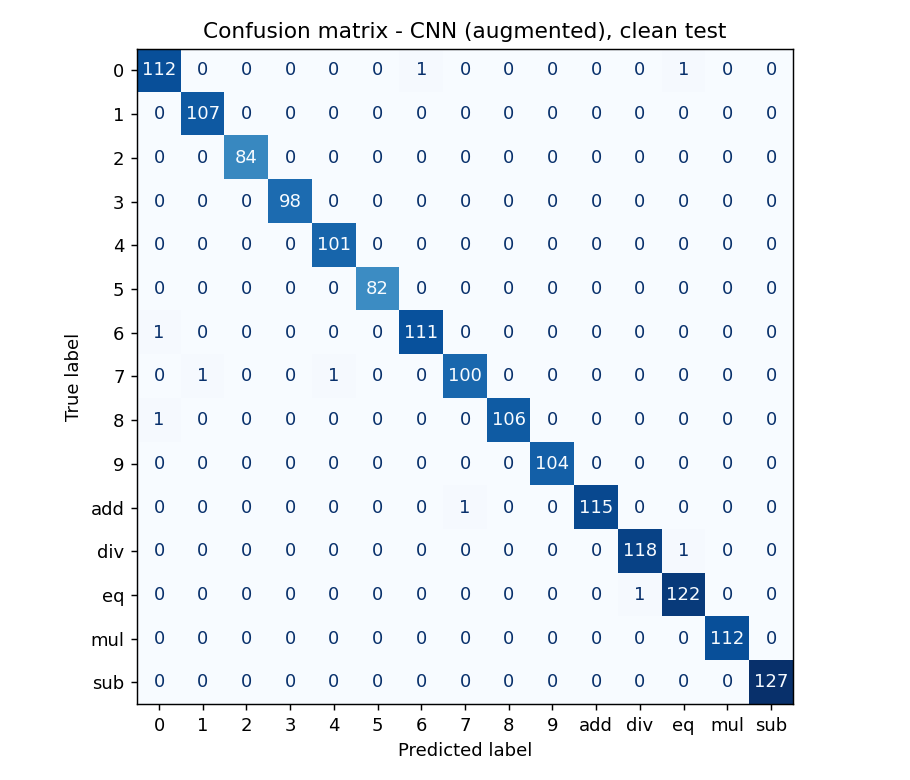
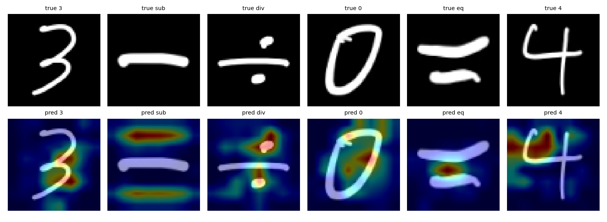

# Handwritten digits & math symbols recognition

Classifier for 15 handwritten classes - digits `0-9` and the symbols `add`, `sub`, `mul`, `div`, `eq` - trained on a self-collected dataset (included in the repo, ~30 MB).
Three models are compared (HOG + linear SVM, a small CNN on real data, the same CNN trained with augmentation), with Grad-CAM explanations and a Gradio demo where you can draw a symbol and get a prediction.

## Results

Test set: 1,608 images, never used for training or model selection. "Augmented test" is a fixed-seed augmented copy of the same test images (robustness check).

| Model | Clean test acc | Clean test F1 | Augmented test acc | Augmented test F1 |
|---|---|---|---|---|
| SVM (HOG) | 0.9639 | 0.9640 | 0.8427 | 0.8466 |
| CNN (real only) | 0.9950 | 0.9952 | 0.7121 | 0.7588 |
| CNN (augmented) | 0.9944 | 0.9946 | 0.9845 | 0.9849 |

What the numbers say:
- On clean images both CNNs are at ~99.5% and are statistically indistinguishable (a difference of one or two images out of 1,608). Augmentation does **not** improve clean-test accuracy here.
- Augmentation matters for robustness: on perturbed images (rotation, pen thickness, occlusion, brightness/noise) the real-only CNN drops to 71%, the augmented CNN keeps 98.5%. Caveat: the perturbed test set uses the same augmentation families as training, so this is robustness to *those* perturbations, not to arbitrary real-world noise.
- The HOG + SVM baseline is respectable (96.4%) but degrades under perturbation too.

Both CNNs ran the full 12 epochs (the cap used for this run; EarlyStopping did not trigger).

| Confusion matrix (augmented CNN) | Grad-CAM |
|---|---|
|  |  |

More figures in `results/`: `comparison.png`, `augmentation_examples.png`; raw numbers in `results/metrics.json`.

## What's inside

- **Data pipeline** - loads class folders, normalises polarity (black-on-white and white-on-black inputs end up identical), crops to the symbol's bounding box (aspect ratio preserved, padded to a square) and resizes to 64x64 grayscale. Training and the demo use the same function.
- **Deduplication** - the raw dataset has 8,384 images; 347 exact duplicates and 1 drawing that appeared under two different labels are removed *before* splitting, leaving 8,036 images, so the same drawing cannot land in both train and test.
- **Split** - stratified train / val / test = 5,785 / 643 / 1,608. Validation drives EarlyStopping and LR scheduling; the test set is used once, at the end.
- **Augmentation** (training split only, 2 extra copies per image) - three hand-written OpenCV families: *stroke* (rotation, thicker/thinner pen, blur), *occlusion* (a random patch hides part of the symbol) and *photometric* (brightness/contrast, noise, small shift).
- **Models** - HOG + `LinearSVC`; a 4-block CNN (Conv-BN-MaxPool x4, GlobalAveragePooling, Dropout 0.5, softmax). The CNN is trained twice, on real data only and on real + augmented data, with identical callbacks.
- **Explainability** - Grad-CAM heatmaps for the CNN.
- **Demo** - Gradio app: draw or upload, choose a model, top-3 probabilities, model input preview, Grad-CAM overlay.

## Quick start

```bash
git clone <this repo> && cd handwritten-math-recognition
python -m venv .venv && source .venv/bin/activate   # Windows: .venv\Scripts\activate
pip install -r requirements.txt
```

Run the demo (trained models are included in `models/`):

```bash
python app.py
```

Retrain and re-evaluate everything (~30-40 min on a CPU, much faster on a GPU):

```bash
python -m src.train --data data/handwritten_dataset --epochs 12
```

Options: `--epochs` (max; EarlyStopping may stop earlier; the reported run used 12), `--aug-per-image 2`, `--seed 42`. Results go to `results/`, models to `models/`. `notebooks/walkthrough.ipynb` runs the same pipeline step by step.

## Dataset

```
data/handwritten_dataset/
  0/  1/  ...  9/  add/  sub/  mul/  div/  eq/       # ~430-660 images per class
```

Black strokes on white background, mostly ~155x135 px (some 400x400), PNG/JPG.

## Project layout

```
app.py                  Gradio demo
src/data.py             loading, dedup, polarity/crop preprocessing, splits
src/augment.py          stroke / occlusion / photometric augmentations
src/models.py           CNN, callbacks, Grad-CAM
src/train.py            training + evaluation + figures
notebooks/walkthrough.ipynb
data/  models/  results/
```

## Notes and limitations

- The augmentations are plain OpenCV transforms, not learned or generative methods.
- Augmented training gives the CNN ~3x more gradient steps than the real-only run; the comparison does not control for that.
- Single split and single seed - differences of a few tenths of a percent on the clean test set are within noise.
- Deduplication removes exact duplicates only; near-duplicates (e.g. the same person's very similar drawings) may still exist across splits, which can make clean-test numbers optimistic.
- The dataset is small and limited in writers/styles, so expect lower accuracy on unfamiliar handwriting. In the demo, SVM outputs a class only (no probabilities).

## License

MIT - see [LICENSE](LICENSE). Author: Altynbek Kabiyev.
